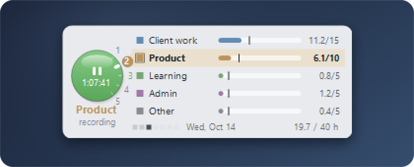
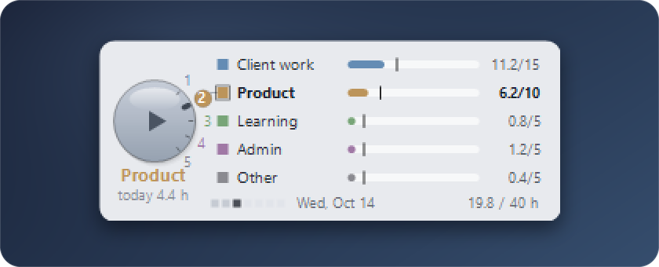
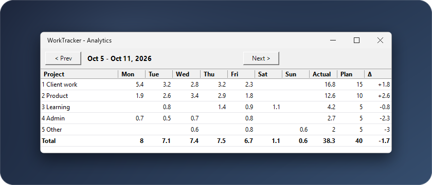

# Time Tracker Widget for Windows

A desktop widget for project time tracking on Windows 10 and 11. It works as a work hours tracker that lives on the wallpaper layer: click the knob to start the timer on a project, and every project shows its hours for the week against a plan. Freelancers and consultants who keep a weekly timesheet get weekly plan vs actual in view all day, without opening an app.

Built with PowerShell and WinForms. No installer, no admin rights, no dependencies beyond the PowerShell that ships with Windows.



## Features

- One round knob starts and stops the timer for the active project. Green means recording, grey means paused.
- Up to 5 projects, each with its own plan in hours per week. The default set uses all five on a 40 h week: Client work 15, Product 10, Learning 5, Admin 5, Other 5.
- Weekly plan vs actual on every row: a bar on one common hour scale with a black tick at the project's plan. Hours past the plan keep filling the bar in the same color.
- Footer with seven day squares (past grey, today dark, future light), today's date, and the week total against the total plan.
- Idle detection: after 25 minutes without keyboard or mouse input the running session is closed at the moment you stopped, and the widget shows "auto-paused". It looks at input only and does not watch for sleep or screen lock, so stop the timer when you leave for the day.
- Global hotkeys: Ctrl+Alt+Shift+9 starts or stops, Ctrl+Alt+Shift+1 to 5 switch project.
- Analytics window with hours per project per day for the current week and every past week, plus the difference to plan.
- Crash recovery: a heartbeat is written every 60 seconds, so a session that was cut short is closed at the last heartbeat on the next start.
- Sits below all windows, has no taskbar button, never takes focus, and remembers its position.
- The full history is a plain text file, one JSON line per work segment.

## Install

Requirements: Windows 10 or 11 and Windows PowerShell 5.1 (built in). No admin rights, no installer.

1. Download the ZIP from the [Releases](https://github.com/datonko-gi/time-tracker-widget/releases) page and unzip it, or run `git clone https://github.com/datonko-gi/time-tracker-widget.git`. Put the folder where you want to keep it.
2. Double-click `install.bat`. It adds a shortcut to your Startup folder that points at this folder, and starts the widget.

The widget starts on every login. If you move the folder later, run `install.bat` again from the new place.

To update, run `uninstall.bat`, replace the files with the new version, and run `install.bat`. Your data is kept.

## Usage



- **Click the knob** to start or stop the active project.
- **Click a number around the knob, or anywhere on a project row**, to switch project. While recording, the running session is closed and a new one starts on the project you picked. Clicking the row that is recording stops it.
- **Mouse wheel over the widget** steps through the projects. While recording it moves the recording to the next project, while paused it only moves the selection. This needs the Windows setting "Scroll inactive windows when I hover over them" (on by default).
- **Drag** anywhere to move the widget. The position is saved.
- **Hotkeys:** Ctrl+Alt+Shift+9 starts or stops the active project, Ctrl+Alt+Shift+1 to 5 switch to project 1 to 5 (pressing the key of the recording project stops it).
- **Right-click** opens the menu for the active project: Analytics and history, Rename project, Plan hours, Add project, Remove this project, Undo last session, Close widget. The first line of the menu shows the project, its position, and hours against plan, for example `Product  (2/5)  ·  6.1/10 h`.

Under the knob the widget shows the project name and a status: `recording`, `paused`, `auto-paused`, or `today 4.4 h` when it is paused and you have logged time today.

All bars share one scale: the largest plan times 4/3, rounded up to a multiple of 5 hours, and never less than 40 hours. With the default plan a full bar is 40 hours.

### Analytics window



Right-click, then Analytics and history. The table lists hours per project and day, the weekly actual, the plan, and the difference. `< Prev` and `Next >` move between weeks.

## Configuration and where data lives

Everything is stored in `%APPDATA%\WorkTracker\`, never in the program folder:

| File | Content |
| --- | --- |
| `data.json` | projects and plan hours, active project, running session, window position |
| `sessions.jsonl` | history, one line per work segment, split at local midnight |
| `widget.log` | start, stop and error lines, trimmed when it grows past about 200 KB |

A line in `sessions.jsonl` looks like this:

```json
{"id":"20261014144000000","n":"Product","s":"2026-10-14T13:25:00","e":"2026-10-14T14:40:00","m":75.0}
```

- Rename projects, change plan hours (1 to 100 per week), add and remove projects from the right-click menu. Renaming rewrites the history so the statistics follow the new name. Removing a project keeps its lines in `sessions.jsonl`.
- The default project list lives in `New-DefaultProjects` in `worktracker.ps1`. It is used only when there is no `data.json` yet.
- The idle limit is `$script:IdleLimitSec` (1500 seconds) in `worktracker.ps1`.
- Days and weeks (Monday to Sunday) follow the local time zone of the PC.
- The history is stored by project name, so keep the names unique. Two projects with the same name share one set of hours.
- The widget holds up to 5 projects: the form is 294 x 115 px and has room for five rows.
- A session that runs across midnight is split at midnight in `sessions.jsonl` once you stop it. While it runs, the widget counts all of it in the current day and week.

## How it works

- The widget is a borderless WinForms form. Each frame is drawn with GDI+ into a 32-bit premultiplied-alpha bitmap and pushed to the window with `UpdateLayeredWindow`. That gives anti-aliased rounded corners and no DWM frame or shadow.
- It is kept at the bottom of the z-order with `SetWindowPos(HWND_BOTTOM)`, and only when something has actually raised it. The `WS_EX_NOACTIVATE` and `WS_EX_TOOLWINDOW` styles keep it out of focus, the taskbar and Alt+Tab.
- A one-second timer repaints while recording, checks idle time with `GetLastInputInfo`, and writes the heartbeat every 60 seconds.
- Hotkeys use `RegisterHotKey`. Wheel and hotkey messages arrive through a small `NativeWindow` hook.
- A named mutex allows one running copy.

## Privacy

- It reads one number from Windows: the time since the last keyboard or mouse input (`GetLastInputInfo`). It does not record keystrokes, window titles or screenshots.
- It sends nothing. The script contains no network code.
- It writes only to `%APPDATA%\WorkTracker\`.

## Uninstall

Run `uninstall.bat`. It removes the Startup shortcut and stops the running widget. Your data stays in `%APPDATA%\WorkTracker\`; delete that folder to remove the history too.

## Troubleshooting

- **Nothing appears after install.** A second copy exits silently because of the single-instance mutex, so check Task Manager for a `powershell.exe` that runs `worktracker.ps1`. Otherwise read `%APPDATA%\WorkTracker\widget.log`.
- **A hotkey does nothing.** Another program already owns that key combination. Windows gives a hotkey to one program only; close the other program or use the knob.
- **The widget is off screen after a monitor change.** On the next start a saved position that is no longer on any screen is moved onto the primary screen. Restart the widget with `uninstall.bat` and `install.bat`.
- **The mouse wheel does not switch projects.** Turn on "Scroll inactive windows when I hover over them" in Settings, Bluetooth & devices, Mouse.

## More widgets

More small Windows desktop widgets and a guide for building your own: [windows-desktop-widgets](https://github.com/datonko-gi/windows-desktop-widgets). A sibling widget with the same look: [habit-tracker-widget](https://github.com/datonko-gi/habit-tracker-widget).

## License

MIT. See [LICENSE](LICENSE).
